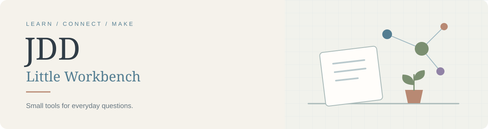
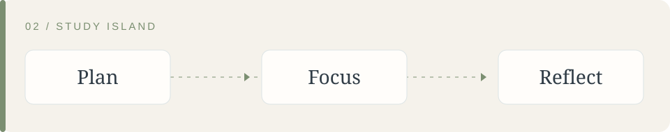
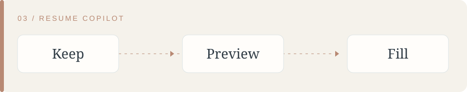

<a href="https://jiaoruotong101-svg.github.io/jiaoruotong101-svg/">
<picture>
  <source media="(prefers-color-scheme: dark)" srcset="https://raw.githubusercontent.com/jiaoruotong101-svg/jiaoruotong101-svg/main/assets/header-dark.svg?v=pastel-1" />
  
</picture>
</a>

**你好，我是 JDD。喵，欢迎来到我的小小工作台。**  
Hi, I'm JDD. Welcome to my little workbench.

把查过的词留下来，把学习的日子记下来，把重复的事情做简单一点。  
Remember the words. Make room for learning. Simplify the repetitive bits.

**Browser extensions　/　Learning tools　/　Everyday web apps**

[关于我 · About](#about) · [项目 · Projects](#projects) · [工具箱 · Toolbox](#toolbox) · [联系 · Contact](#contact)

<!-- field-notes-website:start -->

### 个人作品集 · JOO / FIELD NOTES

项目、科研与交互实验的可探索档案。

[GitHub Pages · 访问作品集](https://jiaoruotong101-svg.github.io/joo-field-notes/) &nbsp; · &nbsp; [Vercel · 备用入口](https://joo-field-notes.vercel.app)

[查看网站源码](https://github.com/jiaoruotong101-svg/joo-field-notes)

<!-- field-notes-website:end -->

---

## 01 / 从日常问题开始 · About

我的公开项目里，有收集英文单词的浏览器扩展，有记录任务、专注和心情的学习小岛，也有减少简历重复录入的填表助手。

它们从很具体的需求出发：查过的词能不能串起来复习？学习时能不能多一点陪伴？同一份简历能不能少填几遍？这个主页用来整理这些尝试，也保留它们还没做完的部分。

About this workbench · English

My public projects explore vocabulary learning, study companionship, and browser form assistance. Each starts with a small, everyday question; this page collects the work and its open ends.

## 02 / 选一个项目逛逛 · Selected projects

[记住查过的词 ↓](#lexgraph)　 ·　 [给学习留一点陪伴 ↓](#study-island)　 ·　 [少填几遍简历 ↓](#resume-copilot)

### 🔗 LexGraph · 让查过的单词连成网

在 Edge 中捕获搜索或选中的英文单词，整理释义、分类和标签，再通过 **SM-2 间隔复习**与**知识图谱**把零散记录串起来。

An Edge extension that turns word lookups into a vocabulary library, with tags, relationships, spaced repetition, and a visual knowledge graph.

`React` · `TypeScript` · `Vite` · `Dexie / IndexedDB`

从查词到复习 / The learning loop

搜索或选词 → 捕获到收件箱 → 整理知识条目 → 分类、标签与关联 → 间隔复习 → 图谱浏览。

目前按仓库说明构建后，以开发者模式加载到 Edge。

### 🌱 学习小岛 · Study Island

一个以陪伴为出发点的学习应用：把**今日任务、番茄钟、错题记录、心情和留言**放在一起，也为彼此交流留出位置。

A study companion bringing together daily tasks, focus sessions, mistake notes, moods, and messages.

`Next.js` · `TypeScript` · `Tailwind CSS` · `Zustand`

小岛里有什么 / Inside the island

- 为任务安排专注时间，回看学习统计。
- 用图片或录音留下错题记录。
- 记录心情、互留纸条，通过配对建立陪伴关系。
- 仓库包含独立聊天服务；实时聊天需要单独配置与部署。

### 📄 求职 Copilot · 少一点重复录入

一个本地优先的 Chrome / Edge 扩展：维护简历内容库，扫描招聘页面，**预览匹配结果后再填写**。目前针对华为招聘页面开发，采用本地规则匹配，不依赖远程大模型。

A local-first browser extension for keeping résumé information and reviewing field matches before filling recruitment forms.

`React` · `TypeScript` · `Manifest V3` · `chrome.storage.local`

> **当前状态：** 已在模拟表单上验证，真实登录后的招聘表单适配仍待核验。最终提交由用户完成。

展开：填写流程与当前边界 / Workflow and limits

维护简历内容库 → 扫描页面 → 核对匹配结果 → 填写已匹配字段 → 人工检查与提交。

自定义下拉和日期等控件仍需人工处理，不能承诺真实招聘页面的完整适配。

---

项目配图为功能流程示意，不是应用界面截图。

## 03 / 项目里用到的工具 · Toolbox

| 用途 | 现有项目中的实践 |
| --- | --- |
| 浏览器扩展 | Manifest V3、侧边栏、页面内容脚本 |
| 本地数据 | IndexedDB / Dexie、chrome.storage.local |
| 网页交互 | React、Next.js、TypeScript、HTML / CSS |
| 开发验证 | Vitest、Playwright（求职 Copilot） |

这里列的是公开项目使用的技术，不是熟练度排名。 / Technologies found in my public projects, not proficiency ratings.

## 04 / 还有一些小页面 · Other corners

[diary](https://github.com/jiaoruotong101-svg/diary) 是一个以情绪记录为主题的 HTML / CSS / JavaScript 小项目。账号里也保留着其他网页尝试，放在[全部仓库](https://github.com/jiaoruotong101-svg?tab=repositories)里慢慢整理。

## 🍬 贡献足迹 · Contribution snake

一条小蛇，沿着我的 GitHub 贡献记录慢慢走。每天自动更新。

<picture>
  <source media="(prefers-color-scheme: dark)" srcset="https://raw.githubusercontent.com/jiaoruotong101-svg/jiaoruotong101-svg/snake-output/github-snake-dark.svg" />
  
</picture>

## 05 / 找到我 · Contact

[GitHub · jiaoruotong101-svg](https://github.com/jiaoruotong101-svg) · [Email](mailto:jiaoruotong101@gmail.com)

项目的问题和建议，欢迎在对应仓库的 Issues 中交流。

[浏览全部项目 ↗](https://github.com/jiaoruotong101-svg?tab=repositories)　 ·　 [回到顶部 ↑](#top)  
For project questions and suggestions, please use the relevant repository's Issues.

---

  <b>小小工作台，慢慢添东西</b> 
  A little workbench, one useful thing at a time.

